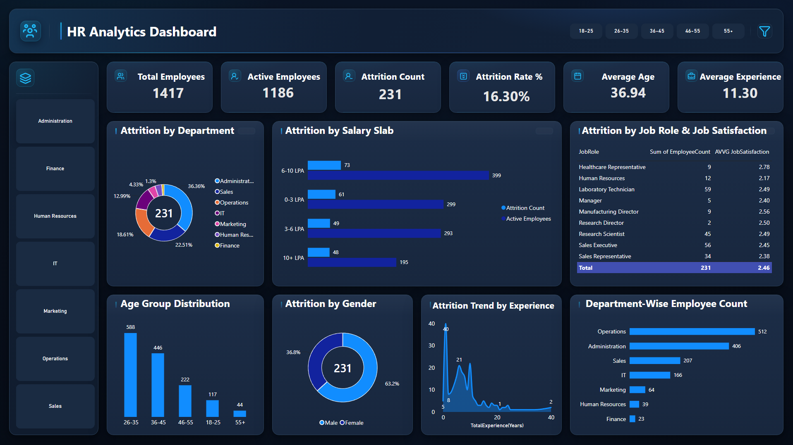

# HR Analytics | Employee Attrition Analysis Dashboard

<p align="center">
  
</p>

<p align="center">
  
  
  
</p>

<p align="center">
  <b>Turning HR Data into Workforce Insights and Employee Retention Intelligence.</b>
</p>

---

## 📌 Project Overview

An interactive HR Analytics Dashboard developed using **Microsoft Power BI** to investigate employee attrition, workforce demographics, salary distribution, and employee satisfaction.

The project focuses on understanding the factors associated with employee turnover and identifying workforce patterns that can support better HR decisions.

Rather than simply presenting descriptive statistics, the analysis explores relationships between different employee attributes to uncover meaningful business insights.

## 🎯 Business Problem

Employee attrition is a major challenge for organizations because it affects workforce stability, recruitment costs, productivity, and long-term business performance.

The main objective is to answer:

- How many employees are leaving the organization?
- Which departments experience the highest attrition?
- Does salary level influence employee turnover?
- Which age groups represent the largest portion of the workforce?
- How does attrition vary across job roles and satisfaction levels?
- Is there a noticeable relationship between professional experience and attrition?

## 📊 Key Performance Indicators

| KPI | Value |
|---|---:|
| Total Employees | 1,417 |
| Active Employees | 1,186 |
| Attrition Count | 231 |
| Attrition Rate | 16.30% |
| Average Age | 36.94 |
| Average Experience | 11.30 Years |

## 📈 Dashboard Analysis

### 1. Attrition by Department
Analyzes employee turnover across different organizational departments to identify where retention challenges are concentrated.

### 2. Attrition by Salary Slab
Compares attrition counts across salary categories to investigate how compensation levels relate to employee turnover.

### 3. Attrition by Job Role & Job Satisfaction
Examines attrition across individual job roles alongside average job satisfaction, helping identify roles that deserve further investigation.

### 4. Age Group Distribution
Visualizes the employee population across different age categories to understand workforce demographics.

### 5. Attrition by Gender
Explores the distribution of employee attrition between male and female employees.

### 6. Attrition Trend by Experience
Investigates how attrition patterns change across years of professional experience.

### 7. Department-Wise Employee Count
Provides a comparison of workforce distribution across all departments.

## 🧠 Analytical Approach & Data Analyst Mindset

This project follows a structured analytical workflow:

| Stage | Approach |
|---|---|
| Business Understanding | Identifying HR challenges and defining analytical questions. |
| Data Validation | Checking employee records, data consistency, and metric definitions. |
| Exploratory Analysis | Investigating demographics, departments, salaries, and job roles. |
| KPI Development | Creating DAX measures for workforce and attrition metrics. |
| Data Visualization | Selecting appropriate visuals to communicate analytical findings. |
| Business Interpretation | Connecting numerical patterns to potential workforce challenges. |

**The focus was on asking the right questions, validating the numbers, and choosing visualizations that communicate meaningful information.**

## 🔍 Key Analytical Observations

- The organization has 1,417 employees, with 1,186 currently active.
- Employee attrition accounts for 231 records, representing 16.30% of the workforce.
- The average employee age is approximately 37 years.
- The workforce has an average professional experience of 11.30 years.
- Department-level analysis highlights differences in workforce distribution and attrition.
- Salary and job-role analysis provide additional dimensions for investigating employee retention.

## ⚙️ Technical Stack

| Technology | Usage |
|---|---|
| Microsoft Power BI | Dashboard development and interactive reporting |
| DAX | Measures and KPI calculations |
| Power Query | Data preparation and transformation |
| Data Visualization | Analytical storytelling and insight communication |

## 🎨 Dashboard Design & Interactivity

The dashboard features a custom **Dark Navy & Cyan** theme designed to provide a consistent and professional analytical experience.

Key design elements:

- Interactive Age Group slicers.
- Department-level filtering.
- Dynamic KPI cards.
- Consistent color palette and visual hierarchy.
- Custom icons and dashboard components.
- Multiple visualizations integrated into one analytical interface.

## 📂 Repository Structure

```text
HR-Analytics-Dashboard/
│
├── screenshots/
│   └── HR-Analytics-Dashboard.png
│
├── HR-Analytics-Dashboard.pbix
│
└── README.md
```

## 🚀 Project Outcome

This project demonstrates the application of Power BI in transforming workforce data into an interactive HR analytics solution.

It combines data validation, exploratory analysis, DAX calculations, visualization design, and business-oriented thinking to investigate employee attrition and workforce distribution.

**My objective as a Data Analyst is not just to build dashboards, but to transform data into insights that help businesses understand problems and make better decisions.**

---

<p align="center">
  <b>Built with Power BI | HR Analytics & Data Storytelling</b>
</p>